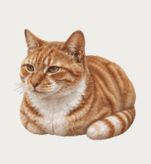
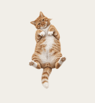
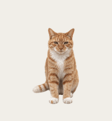

# 栗子 · Codex 自定义桌宠

以真实橘猫「栗子」为参考制作的半写实二维桌宠资源。白胸、白爪、浅色尾尖，右前爪带一小块橘黄色斑点。

当前版 v1.2.0：母鸡蹲待机、轻踩奶工作、抬头等你回复；交互时伸腿侧躺。保留舔爪、左右行走及原有失败和检查动作。露肚摇尾已移除，困得点头保留为备用素材。

| 母鸡蹲待机 | 交互：伸腿侧躺 | 舔爪 | 抬头等你 |
| --- | --- | --- | --- |
|  |  |  |  |

## 安装

- macOS：使用下方脚本。
- Windows：查看 [Windows 安装说明](docs/INSTALL_WINDOWS.md)，包含手动复制、备份、云端角色及 WSL 排查。Windows 实机运行尚未验证。

下载本仓库或 Release 压缩包，在 macOS 终端进入解压目录后运行：

```sh
bash scripts/install.sh
```

脚本将 `pet/` 安装至 `${CODEX_HOME:-$HOME/.codex}/pets/chestnut/`，若已有同名目录，先完整备份到 `pet-backups/`。不修改 Codex 程序或全局配置。安装后在宠物列表选择「栗子（动作扩展版）」，必要时重启应用。

**云端角色提醒：** 部分版本会把本地角色迁移到账号云端。已有云端栗子时，仅覆盖本地文件不会更新云端图集；需要通过 Work Pets 的角色更新功能上传 `pet/spritesheet.webp`，更新原角色。此仓库不包含账号凭据，也不会自动调用云端接口。

## 动作映射

| 原生状态 | 当前画面 | 有效帧数 |
| --- | --- | --- |
| idle | 母鸡蹲、呼吸、慢眨眼 | 6 |
| running-right | 向右移动 | 8 |
| running-left | 向左移动 | 8 |
| waving | 舔爪 | 4 |
| jumping | 伸腿侧躺 | 5 |
| failed | 原失败反馈 | 8 |
| waiting | 抬头等你 | 6 |
| running | 轻踩奶 | 6 |
| review | 原检查动作 | 6 |

动作使用 Codex 已有触发机制，没有增加独立触发器或自动巡游。`jumping` 槽位在本角色中使用伸腿侧躺，不表示实际跳跃。当前版本不再包含露肚摇尾。踩奶交替幅度较轻。

## 格式与验证

- 静态透明 WebP，1536 × 1872，8 列 × 9 行；每格 192 × 208。
- v1，共 57 个有效帧，其余 15 格透明。
- `pet.json` 仅使用已核实的角色配置字段。
- 当前图集已通过本地和云端结构校验，已上传到制作者当前启用的云端角色。
- 左右行走仍存在滑步，尚未通过自然步态验收。新版在其他安装环境中的触发效果需实际确认。

本仓库不包含原始猫咪照片或账号数据。图像由 AI 辅助生成，经参考照片筛选、人工反馈迭代及帧图整理。与 OpenAI 无隶属关系。

[角色设定图](preview/character-sheet.png) · [格式说明](docs/FORMAT.md)
